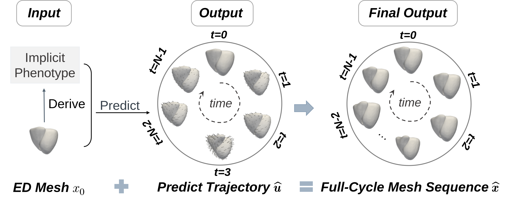
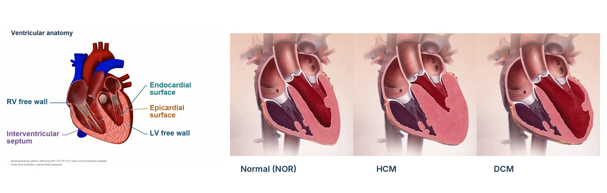
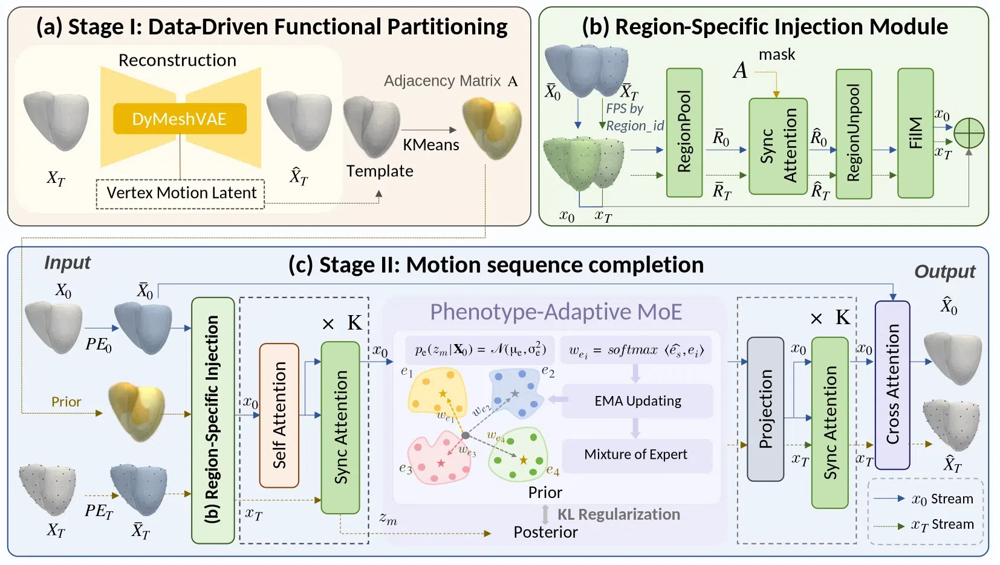
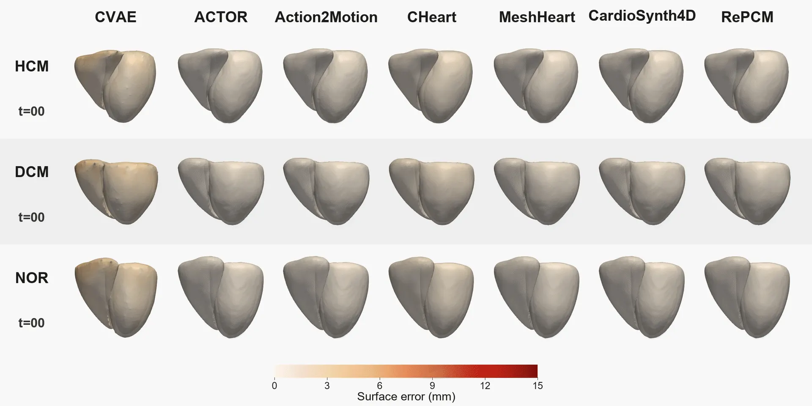
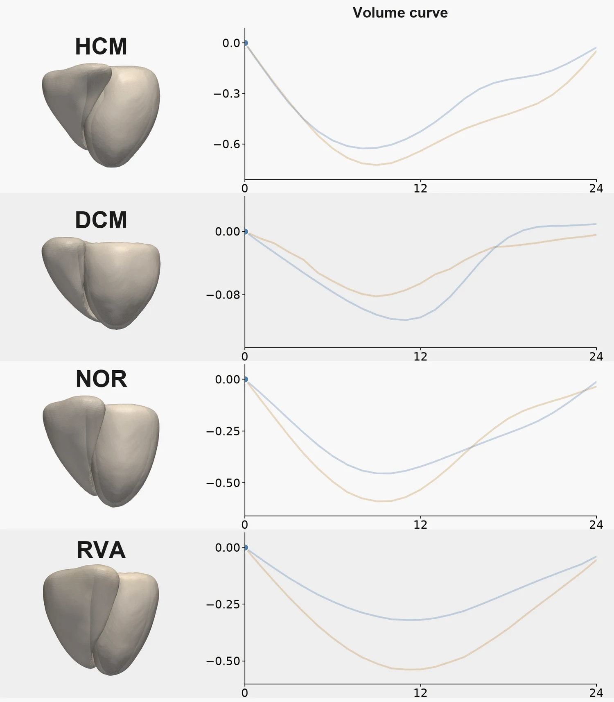
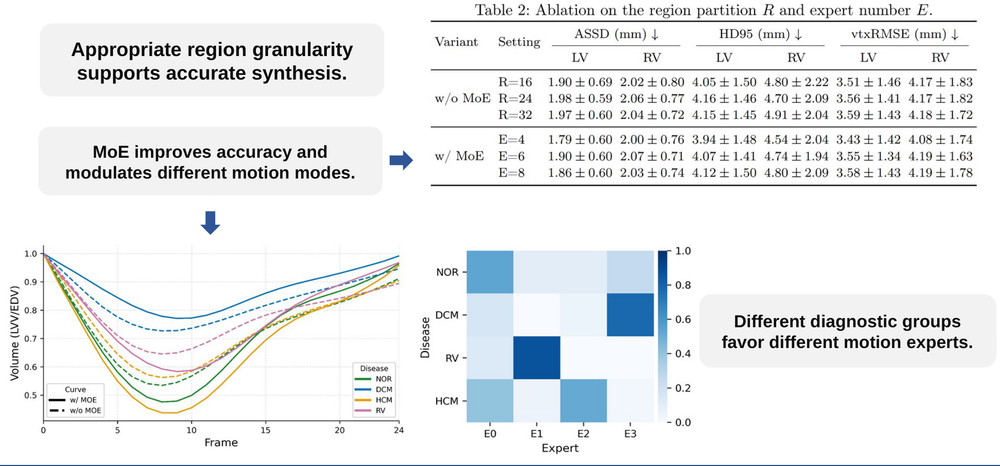

<div align="center">

# RePCM

**Region-Specific and Phenotype-Adaptive Bi-Ventricular Cardiac Motion Synthesis**

*MICCAI 2026*

</div>

RePCM synthesizes full-cycle bi-ventricular mesh motion from a single end-diastolic (ED) shape. Motion-informed regions preserve local dynamics, while shape-conditioned motion experts capture differences between cardiac phenotypes.

## Task

Given a single ED mesh, RePCM predicts its complete motion trajectory to generate a temporally consistent sequence of bi-ventricular meshes.

<p align="center">
  
</p>

## Anatomy and Phenotype Background

Ventricular regions move differently, and cardiac anatomy and contraction vary across normal (NOR), hypertrophic (HCM), and dilated (DCM) hearts.

<p align="center">
  
</p>

## Framework

RePCM first learns functional regions from motion descriptors. Region-specific injection exchanges information between anchors and regions through synchronized attention and FiLM. A shape-conditioned mixture of experts determines the motion prior without diagnostic labels at inference.

<p align="center">
  
</p>

[High-resolution static figure](assets/framework.png)

## Results

**Motion synthesis comparison.** Visual results for NOR, HCM, and DCM.

<p align="center">
  
</p>

**Functional study.** LV and RV volume curves over the cardiac cycle.

<p align="center">
  
</p>

**Ablation study.** Region partition size and phenotype-adaptive motion experts.

<p align="center">
  
</p>

## Code

```text
model/repcm.py                 Region-aware synthesis and motion experts
data/dataloader_new_v3.py      Mesh sequence loading and normalization
loss/mesh_loss.py              Reconstruction and mesh regularization
train/train_repcm.py           Training
inference/generate_motion.py   ED-conditioned motion generation
tests/test_paper_alignment.py  Model alignment checks
```


## Citation

Xuan Yang, Xiaohan Yuan, Hao Li, Lingyu Chen, Yanan Liu, and Lei Li. **RePCM: Region-Specific and Phenotype-Adaptive Bi-Ventricular Cardiac Motion Synthesis.** *MICCAI 2026*.

<sub>Anatomical visualization adapted from jalmer on Sketchfab (CC BY 4.0). Cardiomyopathy animations: Medmovie.</sub>
